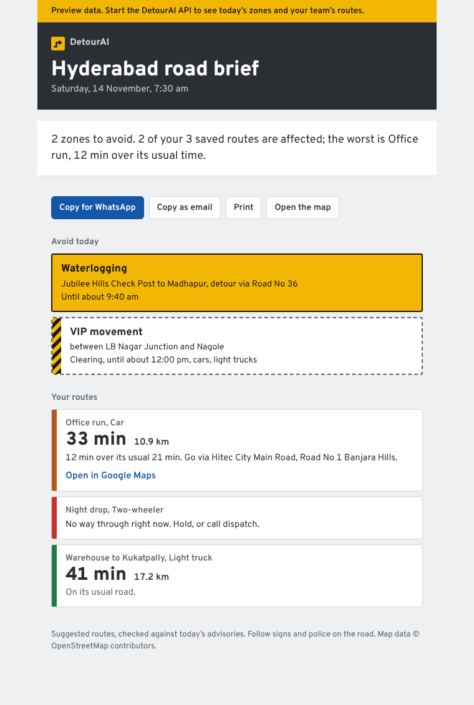
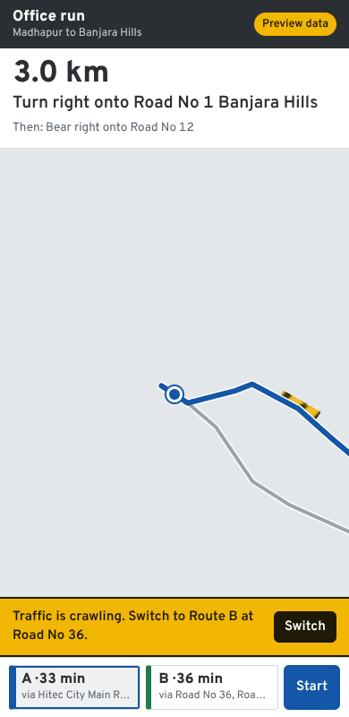

# DetourAI — anomaly-aware, vehicle-dimension routing for Indian cities

Checks the day's route changes (police and civic advisories), turns them into zones on the road
graph, and gives each vehicle class a proper re-route: a scooter and a car do not get the same
detour. Backend-first; commuters get alerts over WhatsApp with a Google Maps handoff, fleets get
an API/SDK. Design, plan and legal review live in the project doc; this repo is the build.

## What works today (v0.11)

| Piece | Where | Status |
| --- | --- | --- |
| Full schema (net, geo, ingest, flow, hydro, telemetry, client), TimescaleDB hypertables | `db/migrations` | done |
| Hyderabad OSM → dimensional network: split at junctions/barriers, width/clearance inference, per-profile exclusion mask, H3 index, unknown gates at barrier nodes | `import/build_network.sql` | done |
| Gazetteer: roads merged by name, junctions, signals, underpasses, flyovers, areas, landmarks, aliases; edges linked to their road feature | `import/build_gazetteer.sql` | done |
| Routing API: Module 2 weighting as pgRouting edge costs over the live overlay; snapping to the nearest allowed road; bidirectional Dijkstra; widening search window; per-profile compare | `api/app/routing.py` | done (turn restrictions wait for GraphHopper) |
| Google Maps handoff: waypoint selection, two-wheeler mode, URL contract | `api/app/maps.py` | done |
| Advisory → IR: text normalization with abbreviation expansion, regex template extraction, optional constrained-JSON LLM path | `api/app/gazetteer.py`, `api/app/ir.py` | done |
| IR → zone: deterministic anchor resolution, displaced-corridor geometry, buffers by cause, directional penalty, merge/decay/expiry, projection onto edges | `api/app/zones.py`, `geo.apply_zone()` | done |
| Console map: routes per profile, paste an advisory and see the polygon, inspect edges, close a gate, refute a zone | `/console` | done |
| Ingestion worker: source registry, RSS / X / TomTom incidents / Open-Meteo pollers, shared pipeline, review queue, lifted-advisory handling | `api/app/worker.py`, `api/app/ingest/` | done (live endpoints untested from the build sandbox) |
| Route packs: up to three size-valid alternates per saved route, turn lists, decision points, best-now status; offline route card with GPS guidance, voice, `#A/#B/#C` links and the crawl rule | `api/app/packs.py`, `/card/{route_id}` | done (corridor basemap for offline not yet bundled) |
| Commuter channel: WhatsApp and Telegram onboarding (consent, vehicle, two pins, travel times), encrypted pins and ids, corridor matching, alert fan-out with Maps button, cleared notices, daily cap, SMS fallback on missing delivery receipt, short links, channel status | `api/app/channels/`, `/webhooks/*`, `/r/{token}`, `/v1/channels` | done (not yet run against live Meta, Telegram or SMS accounts) |
| Place search by name on the console, saved team routes, daily road brief as page, WhatsApp text and email HTML | `/brief`, `api/app/brief.py` | done |

Next: offline corridor basemap for the card, telemetry and stall detection, IMD nowcast adapter, GraphHopper with `net.turn`.

## Prerequisites

- Docker with Compose v2 (Docker Desktop with WSL2 integration works; give it 16 GB+).
- `osmium-tool` and `osm2pgsql` ≥ 1.9 on the host for the import (`apt install osmium-tool osm2pgsql`).
- `southern-zone-latest.osm.pbf` from Geofabrik (https://download.geofabrik.de/asia/india/southern-zone.html) in `data/`.

## Quickstart

```bash
cp .env.example .env                                   # DB_PASSWORD, ADMIN_TOKEN, optional LLM_BASE_URL
make up                                                # db image build ~5 min first time; starts db, redpanda, api
make migrate                                           # db/migrations in order, once each
make import PBF=data/southern-zone-latest.osm.pbf      # bbox extract, osm2pgsql, network, gazetteer (~15-25 min)
make smoke                                             # 2W vs 4W_SUV between two fixed points
open http://127.0.0.1:8080/console                     # the map
```

API docs: http://127.0.0.1:8080/docs. Change the city window with `BBOX=min_lon,min_lat,max_lon,max_lat`.

## The console


The look comes from Indian road signage: diversion-board yellow with black hatching for zones,
informatory-sign blue for actions, route results set as direction-sign plates, numbers in Indian
grouping, and Overpass (a typeface drawn from highway signage). Light and dark follow the system
setting; on a phone the map sits above the panel. Opened without the API (or straight from disk)
the page shows preview data and says so, so the design can be reviewed before the stack is up.

- **Route**: type a place name (suggestions come from the gazetteer) or pick two points on the map, choose vehicles, Compare routes. Lines per vehicle class; the panel shows
  distance, time, snap distance to the road, edges only that profile used, and the Maps link.
- **Advisory**: paste a police-style post. *Resolve (dry run)* shows the IR, each anchor's gazetteer
  match and score, the zone method (displaced corridor, between, single anchor) and draws the polygon.
  *Commit zone* inserts it (ACTIVE at confidence ≥ 0.75, else CANDIDATE) and projects it onto edges,
  so the next Route call already avoids it.
- **Review**: the sentences the pipeline could not place, each with the reason in plain words. Pick the place
  that was meant (from the candidates or by searching) and DetourAI learns the name and re-runs the sentence;
  the tab shows how many are waiting.
- **Roads**: click the map to see widths, who may pass and gate state; close a road to cars or to everyone.
- **Feeds**: every source with its state (working, needs a key, failing, paused), schedule and counts; pause,
  resume, *Check now*, and a form to add a news feed or an X account.
- **Admin access** (top right) holds the token these changes need; it stays in the tab only.

## The road brief (the team newsletter)



`/brief` is the daily "what changed and how to go around it" page for a team: a one-sentence summary,
the zones to avoid as diversion boards, and every saved team route with its time now against its usual
time, the roads to take instead and a Google Maps link when it is affected.

- Save a route: on the console, compare a route, then *Add to the daily brief* on the vehicle's plate.
- **Copy for WhatsApp** puts a ready-to-paste message on the clipboard (`/v1/brief?format=text`).
- **Copy as email** copies an email-safe HTML version (`/v1/brief?format=email`): tables and inline
  styles, so it survives Gmail and Outlook. A cron that mails it at 07:30 is a five-line script.
- **Print** gives a clean one-page sheet for a notice board.
- `/v1/brief` is the same content as JSON, for a partner's own dashboard.

"Usual time" is the same trip routed with every zone ignored, so the delay shown is the delay the
zones cause, not traffic in general.

## Commuter channel

People subscribe by chatting: hi, accept the notice, pick a vehicle, share a start pin and an end pin, pick travel
times. DetourAI keeps a corridor of H3 cells per direction and the two pins encrypted; it never tracks position. A
zone that touches a corridor in its travel window produces one message with a Google Maps button, and one cleared
message when it ends. A WhatsApp alert with no delivery receipt after 60 seconds is repeated by SMS.

Setup, including the two template texts to submit to Meta, is in `docs/CHANNEL_SETUP.md`. With nothing configured
the code runs and sends nothing; the console's Feeds tab shows each channel's state and its next step.

## What is public and what is not

- **Saving a zone is an admin action.** `POST /v1/advisories/paste` is a dry run unless it carries the admin token;
  nothing unsigned can create a closure, reroute traffic, alert subscribers or reach the feed.
- **The public address reaches only the public surface.** When `PUBLIC_BASE_URL` is set, requests arriving for that
  host get the webhooks, short links, the route card and its packs, and the closure feed. The console, the brief, the
  review queue, sources and every admin endpoint answer 404 there and stay on the local address.
- **Licensed feed data is not passed on.** Zones built from TomTom incidents are routed around but never appear in the
  closure feed.

## Crowd reports and the Waze-format feed

- **REPORT** on WhatsApp or Telegram: pick water, closed road or accident, share the pin. It becomes a small zone on
  that road, live for 45 minutes (accident) to 3 hours (closure) unless confirmed.
- **Still blocked?** People alerted about a zone are asked once, 20 minutes later; a few people whose route passes an
  unconfirmed report are asked too. Answers are weighted by each person's trust. About one average person confirms a
  report; about two more saying "clear" remove a crowd report, and shorten (never remove) a police closure. Only people
  who were asked (their route passes the zone) or who reported it may answer, and an account with no confirmed report
  of its own counts for 0.3 at most, so it takes two new accounts to confirm a report and four to end one.
- **Trust** per reporter rises when their reports are confirmed and falls when refuted; it sets how sure their next
  report starts.
- **Closure feed** at `/v1/feeds/cifs.json` and `.xml`, in Waze's CIFS format, for a traffic authority to register
  under Waze for Cities so the closures reach Waze and Google Maps. See `docs/WAZE_FEED.md`.
- **Open in Waze** beside the Google Maps link. Waze takes the destination only and picks its own route.

## Route packs and the offline card



`GET /v1/packs/{route_id}` builds up to three routes for a saved team route: A (best now) and B, C (each sharing at
most 40% of its length with the others, valid for the vehicle). Each has its line, a turn list in road names, its time,
and the decision point where it leaves route A. `GET /v1/packs/{route_id}/status` says which is best right now.

`/card/{route_id}` is the route card: open it once with data and it keeps working without. It guides from the phone's
own GPS, speaks the turns, switches route when the link ends in `#B` (the form an SMS carries), and proposes an
alternate by itself when the phone crawls for four minutes ahead of a turn-off. *Start* begins guidance and keeps
the screen awake. Not yet bundled: an offline basemap for the corridor, so with no data the routes are drawn on a
plain background.

## Verifying correctness

`verify\verify.bat` checks the stack's output against your own trips, tape-measured gates, labelled police advisories,
an independent router (OSRM), Osmose and a blind reviewer, and writes a pass/fail report per criterion. Thresholds are
in `verify/criteria.json`; the full guide, including what to collect and how to read failures, is `verify/VERIFY.md`.

## Testing

| Command | What it runs |
| --- | --- |
| `make test` | 161 unit tests: advisory parser, normalization, Maps and Waze handoff, brief, packs, routing SQL, feed parsers, onboarding and report conversation, channel adapters, CIFS feed, trust and votes |
| `make test-sql` | every SQL file and embedded statement through PostgreSQL's parser |
| `make test-ui` | 25 browser tests of the console (routes, advisories, review, roads, feeds), brief and route card on preview data |
| `make test-live` | 18 end-to-end tests against the running stack (skipped when it is down) |
| `DETOUR_DB=... python -m pytest -m db tests/integration` | reports, answers, trust and the feed against the database; creates and removes its own rows |

`pip install -r requirements-dev.txt` and `python -m playwright install chromium` set up the tools. GitHub Actions
runs the first three on every push (`.github/workflows/tests.yml`). The scenario catalogue, with manual checks for
phones and live feeds, is in `docs/TEST_SCENARIOS.md`.

## Ingestion (the worker)

`docker compose up -d` now also starts a `worker` that polls every source in `ingest.source` when it is due and
runs the same advisory-to-zone path as the console's paste box. See the status at `/v1/sources`.

| Source kind | What it brings | Needs |
| --- | --- | --- |
| `RSS` | News items that quote police advisories; the article's action sentences each become one zone attempt | the feed URL, added with `POST /v1/sources` |
| `X` | A handle's own posts (no replies, no reposts), polled with `since_id` on pay-per-use credits | `X_BEARER_TOKEN` in `.env`, the handle added with `POST /v1/sources` |
| `TOMTOM_INCIDENTS` | Closures, road works, flooding and accidents with geometry; closures and flooding commit as active zones | `TOMTOM_KEY` in `.env` (seeded, 20-minute interval) |
| `OPEN_METEO` | Hourly rain on a 0.05 degree grid into `hydro.rain_cell` | nothing (seeded, hourly; non-commercial use only) |

Add a feed or a handle (admin token):

```bash
curl -X POST http://127.0.0.1:8080/v1/sources -H "X-Admin-Token: $ADMIN_TOKEN" -H "Content-Type: application/json" \
  -d '{"kind":"RSS","name":"Telangana Today Hyderabad","handle":"<feed url>","cred":0.75,"interval_s":300}'
curl -X POST http://127.0.0.1:8080/v1/sources -H "X-Admin-Token: $ADMIN_TOKEN" -H "Content-Type: application/json" \
  -d '{"kind":"X","name":"Hyderabad Traffic Police","handle":"@HYDTP","cred":0.9,"interval_s":600}'
```

Confirm each outlet's feed URL in a browser before adding it; a wrong URL shows as `failing` in `/v1/sources`.

**Review queue.** A sentence the pipeline cannot place goes to `ingest.review` with the closest gazetteer matches
(`GET /v1/review`). Resolving it with `{"action":"alias","gaz_id":…}` teaches the gazetteer that spelling and
re-runs the sentence; `{"action":"dismiss"}` drops it. This is the 20-minutes-a-day human check from the plan.

**The full police form.** "Traffic from A towards B will be diverted at C towards D via E" is read as: the stretch
C to B is shut; D and E are the way round. The zone covers C to B only.

**Tests.** `make test` runs the parser tests (RSS, X, TomTom, Open-Meteo, advisory sentences) with no network or database.

## Vehicle rules

- **Fit** is single file: a vehicle may use a lane at least its own width plus 0.4 m, one-way or two-way. On a two-way
  lane narrower than two of that vehicle side by side plus 0.4 m, travel time is multiplied by 1.5 (`NARROW_TWO_WAY_MULT`),
  because oncoming traffic has to wait. A 1.5 m gate gap is open to scooters and closed to cars.
- **OSM access tags** close an edge per vehicle: the most specific key present decides (`motorcycle` for two-wheelers,
  `motorcar` for cars, `goods` for light trucks, `hgv` for trucks, `bus`/`psv` for buses, then `motor_vehicle`,
  `vehicle`, `access`). Only `no` closes; `private` gated layouts follow the layout rule and the gate cost.
- **Re-imports** keep nodes in place, so hand-mapped gates (with their cut sets), sinks with their hydrology, and
  submersion alert history survive.

## Fine-tuning knobs

| Where | What to tune | Why |
| --- | --- | --- |
| `geo.abbreviation` | city shorthand (`jn`, `x roads`, `pvnr`, …) | most DLQ misses are an unknown short form; add the row, no code |
| `geo.gazetteer_alias` | extra spellings per feature | code-mixed and transliterated names (`neellu`, `chowrasta`) |
| `net.edge_dim.width_m` + `width_src` | measured widths for the lanes that matter | the class default is a guess; one field check per gate alley fixes the 2W/4W split there |
| `net.vehicle_profile` | fleet-specific dimensions | a partner's LCV is not the default LCV |
| `zones.BUFFER_M`, `TTL_MIN`, `PENALTY` | per-cause geometry and lifetime | tune against the 100-zone audit |
| `routing.py` constants (`ZONE_SOFT_MULT`, `UNKNOWN_GATE_COST_S`) | how hard a soft zone or an unknown gate pushes a route away | watch for detours that are longer than the delay they avoid |
| `ir.py` `_DIVERT`, `_AT`, `_BETWEEN` | the template regexes | add a shape when a frequent post form returns `None`; the LLM path covers the rest |

## Updating this repo from a downloaded zip (Windows)

Each update arrives as `detourai-<version>-update.zip` holding only the files that changed.

1. Download the zip (it lands in Downloads).
2. In the repo folder, double-click `apply-update.bat`.
3. It unpacks the newest update zip over the repo, lists the files that changed, and asks before it commits and pushes.

Answer N to stop after the files are in place without committing. Running it twice is harmless: the second run says nothing changed.

## Layout

```
db/            Dockerfile (PostGIS + pgRouting + h3 + Timescale), migrate.sh, migrations/*.sql
import/        detour.lua (osm2pgsql flex), import_osm.sh, build_network.sql, build_gazetteer.sql, build_turns.sql
api/app/       main.py (endpoints), routing.py, maps.py, gazetteer.py, ir.py, zones.py, static/console.html
scripts/       smoke.sh
```

## Notes

- Routing v0 ignores turn restrictions and turn radii; `make turns` builds `net.turn` for GraphHopper.
- `net.*` and the gazetteer are derived from OpenStreetMap (ODbL). Telemetry, gate states, zones,
  subscriptions and hand-mapped layouts live in separate tables and stay yours.
- Console basemap tiles come from OpenFreeMap (free, third-party); the fallback is a PMTiles file served locally.
- The LLM path only runs when `LLM_BASE_URL` is set; it never sees a coordinate and its output is
  validated against the IR schema before anything is resolved.
