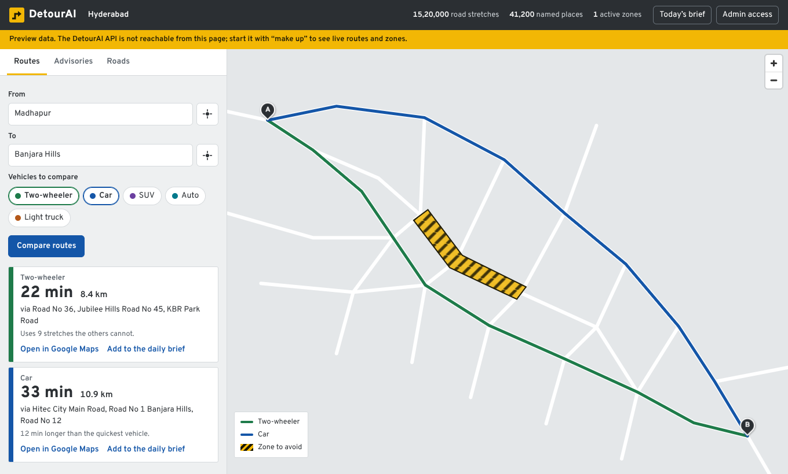

# DetourAI — anomaly-aware, vehicle-dimension routing for Indian cities

Checks the day's route changes (police and civic advisories), turns them into zones on the road
graph, and gives each vehicle class a proper re-route: a scooter and a car do not get the same
detour. Backend-first; commuters get alerts over WhatsApp with a Google Maps handoff, fleets get
an API/SDK. Design, plan and legal review live in the project doc; this repo is the build.

## What works today (v0.4)

| Piece | Where | Status |
| --- | --- | --- |
| Full schema (net, geo, ingest, flow, hydro, telemetry, client), TimescaleDB hypertables | `db/migrations` | done |
| Hyderabad OSM → dimensional network: split at junctions/barriers, width/clearance inference, per-profile exclusion mask, H3 index, unknown gates at barrier nodes | `import/build_network.sql` | done |
| Gazetteer: roads merged by name, junctions, signals, underpasses, flyovers, areas, landmarks, aliases; edges linked to their road feature | `import/build_gazetteer.sql` | done |
| Routing API: Module 2 weighting as pgRouting edge costs over the live overlay; snapping to the nearest allowed road; bidirectional Dijkstra; widening search window; per-profile compare | `api/app/routing.py` | done (turn restrictions wait for GraphHopper) |
| Google Maps handoff: waypoint selection, two-wheeler mode, URL contract | `api/app/maps.py` | done |
| Advisory → IR: text normalization with abbreviation expansion, regex template extraction, optional constrained-JSON LLM path | `api/app/gazetteer.py`, `api/app/ir.py` | done |
| IR → zone: deterministic anchor resolution, displaced-corridor geometry, buffers by cause, directional penalty, merge/decay/expiry, projection onto edges | `api/app/zones.py`, `geo.apply_zone()` | done |
| Console map: routes per profile, paste an advisory and see the polygon, inspect edges, close a gate, refute a zone | `/console` | done |
| Ingestion worker: source registry, RSS / X / TomTom incidents / Open-Meteo pollers, shared pipeline, review queue, lifted-advisory handling | `api/app/worker.py`, `api/app/ingest/` | done (live endpoints untested from the build sandbox) |
| Place search by name on the console, saved team routes, daily road brief as page, WhatsApp text and email HTML | `/brief`, `api/app/brief.py` | done |

Next: review queue and source status in the console, WhatsApp channel and corridors, telemetry and stall
detection, IMD nowcast adapter, TomTom flow speeds, GraphHopper with `net.turn`.

## Prerequisites

- Docker with Compose v2 (Docker Desktop with WSL2 integration works; give it 16 GB+).
- `osmium-tool` and `osm2pgsql` ≥ 1.9 on the host for the import (`apt install osmium-tool osm2pgsql`).
- `southern-zone-latest.osm.pbf` from Geofabrik (https://download.geofabrik.de/asia/india/southern-zone.html) in `data/`.

## Quickstart

```bash
cp .env.example .env                                   # DB_PASSWORD, ADMIN_TOKEN, optional LLM_BASE_URL
make up                                                # db image build ~5 min first time; starts db, redpanda, api
make migrate                                           # db/migrations in order, once each
make import PBF=data/southern-zone-latest.osm.pbf      # bbox extract, osm2pgsql, network, gazetteer (~15-25 min)
make smoke                                             # 2W vs 4W_SUV between two fixed points
open http://127.0.0.1:8080/console                     # the map
```

API docs: http://127.0.0.1:8080/docs. Change the city window with `BBOX=min_lon,min_lat,max_lon,max_lat`.

## The console



The look comes from Indian road signage: diversion-board yellow with black hatching for zones,
informatory-sign blue for actions, route results set as direction-sign plates, numbers in Indian
grouping, and Overpass (a typeface drawn from highway signage). Light and dark follow the system
setting; on a phone the map sits above the panel. Opened without the API (or straight from disk)
the page shows preview data and says so, so the design can be reviewed before the stack is up.

- **Route**: type a place name (suggestions come from the gazetteer) or pick two points on the map, choose vehicles, Compare routes. Lines per vehicle class; the panel shows
  distance, time, snap distance to the road, edges only that profile used, and the Maps link.
- **Advisory**: paste a police-style post. *Resolve (dry run)* shows the IR, each anchor's gazetteer
  match and score, the zone method (displaced corridor, between, single anchor) and draws the polygon.
  *Commit zone* inserts it (ACTIVE at confidence ≥ 0.75, else CANDIDATE) and projects it onto edges,
  so the next Route call already avoids it.
- **Admin** (token): click a zone to refute/activate/expire; *Inspect edges* then click the map to see
  widths, who may pass, gate state, and close a gate with or without a two-wheeler gap.

## The road brief (the team newsletter)


`/brief` is the daily "what changed and how to go around it" page for a team: a one-sentence summary,
the zones to avoid as diversion boards, and every saved team route with its time now against its usual
time, the roads to take instead and a Google Maps link when it is affected.

- Save a route: on the console, compare a route, then *Add to the daily brief* on the vehicle's plate.
- **Copy for WhatsApp** puts a ready-to-paste message on the clipboard (`/v1/brief?format=text`).
- **Copy as email** copies an email-safe HTML version (`/v1/brief?format=email`): tables and inline
  styles, so it survives Gmail and Outlook. A cron that mails it at 07:30 is a five-line script.
- **Print** gives a clean one-page sheet for a notice board.
- `/v1/brief` is the same content as JSON, for a partner's own dashboard.

"Usual time" is the same trip routed with every zone ignored, so the delay shown is the delay the
zones cause, not traffic in general.

## Ingestion (the worker)

`docker compose up -d` now also starts a `worker` that polls every source in `ingest.source` when it is due and
runs the same advisory-to-zone path as the console's paste box. See the status at `/v1/sources`.

| Source kind | What it brings | Needs |
| --- | --- | --- |
| `RSS` | News items that quote police advisories; the article's action sentences each become one zone attempt | the feed URL, added with `POST /v1/sources` |
| `X` | A handle's own posts (no replies, no reposts), polled with `since_id` on pay-per-use credits | `X_BEARER_TOKEN` in `.env`, the handle added with `POST /v1/sources` |
| `TOMTOM_INCIDENTS` | Closures, road works, flooding and accidents with geometry; closures and flooding commit as active zones | `TOMTOM_KEY` in `.env` (seeded, 20-minute interval) |
| `OPEN_METEO` | Hourly rain on a 0.05 degree grid into `hydro.rain_cell` | nothing (seeded, hourly; non-commercial use only) |

Add a feed or a handle (admin token):

```bash
curl -X POST http://127.0.0.1:8080/v1/sources -H "X-Admin-Token: $ADMIN_TOKEN" -H "Content-Type: application/json" \
  -d '{"kind":"RSS","name":"Telangana Today Hyderabad","handle":"<feed url>","cred":0.75,"interval_s":300}'
curl -X POST http://127.0.0.1:8080/v1/sources -H "X-Admin-Token: $ADMIN_TOKEN" -H "Content-Type: application/json" \
  -d '{"kind":"X","name":"Hyderabad Traffic Police","handle":"@HYDTP","cred":0.9,"interval_s":600}'
```

Confirm each outlet's feed URL in a browser before adding it; a wrong URL shows as `failing` in `/v1/sources`.

**Review queue.** A sentence the pipeline cannot place goes to `ingest.review` with the closest gazetteer matches
(`GET /v1/review`). Resolving it with `{"action":"alias","gaz_id":…}` teaches the gazetteer that spelling and
re-runs the sentence; `{"action":"dismiss"}` drops it. This is the 20-minutes-a-day human check from the plan.

**The full police form.** "Traffic from A towards B will be diverted at C towards D via E" is read as: the stretch
C to B is shut; D and E are the way round. The zone covers C to B only.

**Tests.** `make test` runs the parser tests (RSS, X, TomTom, Open-Meteo, advisory sentences) with no network or database.

## Fine-tuning knobs

| Where | What to tune | Why |
| --- | --- | --- |
| `geo.abbreviation` | city shorthand (`jn`, `x roads`, `pvnr`, …) | most DLQ misses are an unknown short form; add the row, no code |
| `geo.gazetteer_alias` | extra spellings per feature | code-mixed and transliterated names (`neellu`, `chowrasta`) |
| `net.edge_dim.width_m` + `width_src` | measured widths for the lanes that matter | the class default is a guess; one field check per gate alley fixes the 2W/4W split there |
| `net.vehicle_profile` | fleet-specific dimensions | a partner's LCV is not the default LCV |
| `zones.BUFFER_M`, `TTL_MIN`, `PENALTY` | per-cause geometry and lifetime | tune against the 100-zone audit |
| `routing.py` constants (`ZONE_SOFT_MULT`, `UNKNOWN_GATE_COST_S`) | how hard a soft zone or an unknown gate pushes a route away | watch for detours that are longer than the delay they avoid |
| `ir.py` `_DIVERT`, `_AT`, `_BETWEEN` | the template regexes | add a shape when a frequent post form returns `None`; the LLM path covers the rest |

## Updating this repo from a downloaded zip (Windows)

Each update arrives as `detourai-<version>-update.zip` holding only the files that changed.

1. Download the zip (it lands in Downloads).
2. In the repo folder, double-click `apply-update.bat`.
3. It unpacks the newest update zip over the repo, lists the files that changed, and asks before it commits and pushes.

Answer N to stop after the files are in place without committing. Running it twice is harmless: the second run says nothing changed.

## Layout

```
db/            Dockerfile (PostGIS + pgRouting + h3 + Timescale), migrate.sh, migrations/*.sql
import/        detour.lua (osm2pgsql flex), import_osm.sh, build_network.sql, build_gazetteer.sql, build_turns.sql
api/app/       main.py (endpoints), routing.py, maps.py, gazetteer.py, ir.py, zones.py, static/console.html
scripts/       smoke.sh
```

## Notes

- Routing v0 ignores turn restrictions and turn radii; `make turns` builds `net.turn` for GraphHopper.
- `net.*` and the gazetteer are derived from OpenStreetMap (ODbL). Telemetry, gate states, zones,
  subscriptions and hand-mapped layouts live in separate tables and stay yours.
- Console basemap tiles come from OpenFreeMap (free, third-party); the fallback is a PMTiles file served locally.
- The LLM path only runs when `LLM_BASE_URL` is set; it never sees a coordinate and its output is
  validated against the IR schema before anything is resolved.
